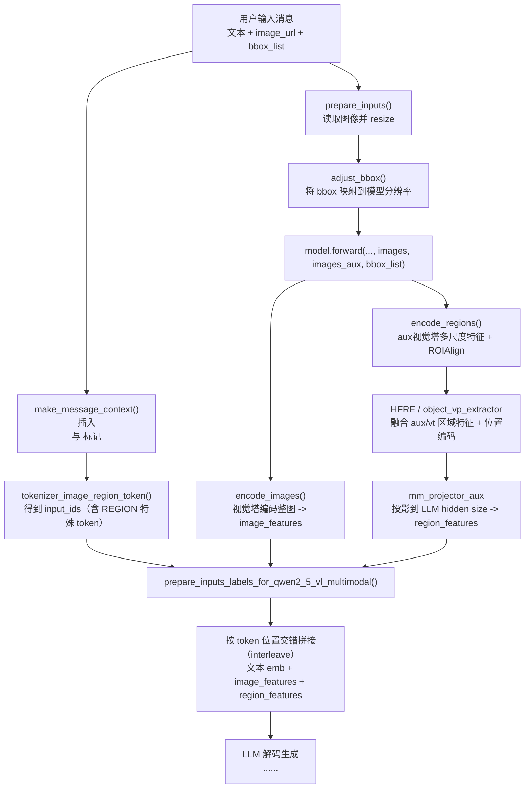

# CoVT / VLM-FO1 项目核心流程与创新点说明

本文基于当前仓库中的训练与推理代码整理，重点对应以下文件：

- `scripts/train_stage1_align.py`
- `scripts/train_stage2_cot.py`
- `scripts/train_cervical_stage2.py`
- `dataset/cervical_dataset.py`
- `vlm_fo1/mm_utils.py`
- `detect_tools/upn/inference_wrapper.py`
- `scripts/inference_with_upn.py`

---

## 1. 项目总体目标

该项目以 `VLM-FO1_Qwen2.5-VL-3B` 为基础，构建“细粒度区域感知 + 多任务医学问答/定位/分类”系统，核心思路是：

1. 先把通用 VLM 对齐到宫颈细胞场景（Stage-1，领域适配）；
2. 再进行 CoT 与多任务注入（Stage-2/Stage-B），在不破坏已有能力的前提下提升任务表现；
3. 在推理时统一使用 region token 机制（`<regionX>`）进行定位、区域描述、分类任务。

---

## 2. 数据与输入组织（统一格式）

数据样本在训练/评估/Gradio 中遵循同构结构：

- 图像路径：`image`
- ROI 列表：`regions`，每个 region 含 `bbox` 与 `region_id`
- 对话：`conversations`（`user` + `assistant`）
- 任务编号：`task_id`（0~5）

`dataset/cervical_dataset.py` 会将其转成模型输入：

- 文本部分：`<|im_start|>user ...`
- 图像 token：`<image>`
- 区域 token：`<region0><regionfeat> ...`
- `bbox_list`：与 region token 下标一一对应，供 HFRE/ROIAlign 路径使用。

---

## 3. ROI Proposal 流程（Grounding DINO 范式 + VLM-FO1）

微调 Grounding DINO 生成 ROI proposal

当前仓库中**未包含显式 Grounding DINO训练脚本**（主要是推理接入与过滤）。  
如果你们在外部完成了 proposal 模型微调，只需要替换 proposal 权重并保持输出为 `xyxy bbox list`，即可无缝接入本项目的 region token 训练/推理链路。

---

## 4. 两阶段训练策略（核心）

## 4.1 Stage-1：领域对齐（`train_stage1_align.py`）

目标：把通用 VLM-FO1 适配到宫颈细胞语域与 region 表达。

关键策略：

- 基座：`resources/VLM-FO1_Qwen2.5-VL-3B-v01`
- 冻结：`vision_tower`（保留通用视觉能力）
- 训练模块（配置默认）：
  - LLM LoRA（`q/k/v/o + gate/up/down`）
  - `mm_projector`
  - `mm_projector_aux`
- 数据任务：以定位与区域描述为主（task0/1/2）
- 不使用 path feature（`path_feature_root=None`）

结果：得到领域对齐的 Stage-1 模型（常见目录：`outputs/stage1_align*`）。

## 4.2 Stage-2（CoT 注入）：`train_stage2_cot.py`

目标：在 Stage-1 知识基础上注入 CoT 与多任务能力，同时减轻灾难性遗忘。

核心做法：

1. 加载 Stage-1（完整模型或 LoRA），必要时先 merge；
2. 冻结大部分主干：
   - `vision_tower`
   - `vision_projector`
   - `region_projector`
   - LLM MLP（`gate/up/down`）
3. 仅训练更小 LoRA（Attention 子模块）：
   - `q_proj`
   - `k_proj`
   - `v_proj`
   - `o_proj`
4. 可选混合 Stage-1 数据（`mix_stageA_data`）缓解遗忘；

这是一种“先对齐、后推理注入”的典型两阶段策略。

---

## 5. 项目创新点总结

可归纳为四点：

1. **两阶段训练策略**
   - Stage-1：领域对齐（较宽模块可训）；
   - Stage-2：CoT 注入（仅 Attention-LoRA，最小扰动）。

2. **区域 token 驱动的多任务统一接口**
   - 定位、区域描述、分类共享 `<regionX> + bbox_list` 机制，减少任务割裂。

3. **Proposal-Reasoning 解耦**
   - 前端 proposal（Grounding DINO 范式）与后端 VLM-FO1 推理分离，便于替换检测器并独立优化。

---

## 附：`<region0>` -> `region_features` -> LLM 输入序列 简图

说明：

- `region_features` 不是直接用 bbox 坐标，而是经过视觉编码（ROIAlign + HFRE + projector）得到的语义向量。
- 在输入到 LLM 时，`region_features` 与 `image_features` 都是以“替换对应特殊 token 位置”的方式进入同一序列。

